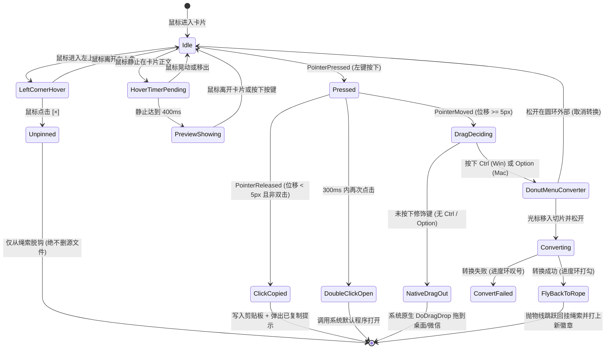

# Clothesline（晾衣绳）跨平台融合工程实施清单 (v3.0 深度完全版)

> **项目定位**：将 **PicRope（图绳）** 的拟物物理悬挂、屏幕边缘感应滑出与随手取用体验，与 **Filee** 精选的高频格式转换轮盘深度融合，打造一款同时原生兼容 **Windows** 和 **macOS** 的次世代桌面常驻暂存架与“秒级”格式转换工作台。
> **技术底座**：C# 12/13 + .NET 8 / .NET 10 + Avalonia UI 11.x（纯原生 Skia/Metal/DirectX 硬件加速管线，单进程低开销）。

---

## 【架构准则：纯净重构铁律（Clean-Room Rewrite）】
> [!IMPORTANT]
> **绝对零耦合与独立生命周期原则**：
> 1. **独立目录树规范**：所有 Clothesline 的源代码、解决方案与配置文件全部统一建在 `D:\Clothesline\src\Clothesline.*` 下，形成自闭环的代码仓库结构。
> 2. **严禁任何相对路径依赖**：项目工程文件（`.csproj`）**严禁包含任何指向 `..\PicRope` 或 `..\Filee` 的相对路径引用、程序集引用或本地包引用**。PicRope 与 Filee 仅作为交互手感、数学物理公式与业务逻辑的设计参考。
> 3. **公网标准依赖规范**：所有第三方库**仅限通过官方公网 NuGet 获取**（如 `Avalonia 11.x`、`SkiaSharp`、`PdfPig`、`PDFtoImage` 等），确保新项目具备 100% 独立的构建与分发能力。
> 4. **随时可删原项目**：一旦 Clothesline 基础工程与功能就绪，用户可随时彻底物理删除现有的 `PicRope\` 和 `Filee\` 文件夹，Clothesline 的编译、构建、测试与运行绝不发生任何破坏！

---

## 一、 核心需求与交互规范（手势与行为矩阵）

### 1. 核心手势与操作规范矩阵
| 操作手势 | 触发动作 | 详细行为与心智模型 |
| :--- | :--- | :--- |
| **鼠标移动到卡片** | **左上角浮现叉号 `×`** | 鼠标移入卡片区域，卡片**左上角**平滑淡入（150ms）半透明圆形叉号图标，移出平滑淡出。 |
| **点击叉号** | **仅从晾衣绳解挂（绝不删本地文件）** | **绝对不删除任何本地磁盘文件！** 仅将该条目从绳索展示列表脱钩并持久化更新 `state.json`，夹子松开弹起，卡片下坠淡出。零误删风险。 |
| **鼠标单击卡片** | **直接复制文件到剪贴板** | 鼠标在卡片上按下并在原地松开（位移 $< 5\text{px}$），立即将文件路径写入系统原生剪贴板（`CF_HDROP` / `NSPasteboard`），卡片下方弹出 `✓ 已复制` 提示气泡并伴随轻微回弹。可直接在微信/QQ/文件夹中 `Ctrl+V` 粘贴。 |
| **双击卡片** | **调用系统默认程序打开** | 双击直接调用操作系统默认关联应用打开源文件。 |
| **长时间悬浮在卡片上** | **展示大尺寸多模态预览** | 鼠标静止在卡片上达到 400ms，弹出大尺寸高清预览浮窗。离开立即关闭。图片看高清大图，PDF/Office 自动渲染第 1 页封面，文本/代码看前 20 行高亮摘要，音视频看首帧与时长。 |
| **普通拖动（无修饰键）** | **原生系统文件拖放 (Drag-Out)** | 像在资源管理器里拖动文件一样，直接按住文件拖走，支持放入**任何桌面、文件夹、聊天软件或办公文档**，松手即放下。拖出成功后卡片继续保留在绳上（用户若不要需点叉号）。 |
| **按住 Ctrl 拖动文件**<br>*(macOS 为 Option+拖动)* | **★ 唤起 Filee 精选转换轮盘！** | 拖动卡片的同时按下 `Ctrl`（Mac 上为 `Option`），光标处**立刻弹出 Filee 经典的 DonutMenu 格式转换圆环**！拖到想要的格式切片上松手即开始转换，轮盘变身动态进度环，转换成功后**新文件自动以抛物线回挂晾衣绳**！ |
| **右键卡片** | **弹出上下文管理菜单** | 弹出右键菜单：<br>1. **💾 保存副本...**（另存为永久文件）；<br>2. **📂 在文件夹/访达中定位**；<br>3. **👁️ 打开文件**；<br>4. **📋 复制文件**；<br>5. **🧹 从绳子取下**（仅解挂）。 |
| **鼠标触碰屏幕最顶端** | **晾衣绳展开 / 收起** | 光标触碰屏幕最顶端边缘（Windows $Y \le 2\text{px}$，Mac 触碰菜单栏顶部），驻留 300ms 后晾衣绳物理下垂滑出；光标离开展示区域 350ms 后平滑收起。 |
| **外部文件拖入 (Drag-In)** | **将任意文件挂上绳子** | 从桌面或文件夹拖着文件碰触屏幕顶端时，顶端透明感应层即时感知并唤起晾衣绳展开，松手释放后卡片被夹子夹住，产生弹性下坠震颤。支持单选/多选任意文件。 |
| **鼠标滚轮横向滚动** | **水平浏览绳索卡片** | 鼠标悬浮在绳索空白区域时，滚动滚轮可平滑横向平移卡片队列（带惯性回弹）。 |
| **全局快捷键** | **手动强制展开/收起绳索** | 默认 `Ctrl+Alt+T`（Mac 为 `Cmd+Opt+T`），无论光标在哪一键呼出/隐藏绳索。 |

---

## 二、 手势防误触有限状态机 (FSM)

为了彻底解决 **单击复制**、**双击打开**、**普通拖拽**、**Ctrl 拖拽唤醒轮盘**、**长时间悬浮预览** 之间的手势冲突，卡片交互由以下精确的有限状态机驱动：



---

## 三、 拟物物理动效与精确数学参数

衣服卡片、绳索下垂与夹子咬合的自然手感完全依赖于二阶阻尼物理系统，核心参数直接从 PicRope 的工程实践中提炼并微调：

### 1. 二阶弹簧方程参数表
| 物理构件 | 固有角频率 $\omega$ (速度/硬度) | 阻尼比 $\zeta$ (弹性感) | 初始扰动位移 | 视觉物理表现 |
| :--- | :--- | :--- | :--- | :--- |
| **晾衣绳整体滑出** | $\omega = 0.42$ | $\zeta = 0.82$ | $-H \to 0$ | 从屏幕顶端顺滑下垂展开，末端有极其微弱的停顿回弹 |
| **绳索主弧线受力下垂** | $\omega = 0.55$ | $\zeta = 0.78$ | $0 \to \Delta Y_{sag}$ | 卡片挂上或鼠标拨弄时，三次贝塞尔绳索下沉并轻微波浪回弹 |
| **卡片挂上重力下落** | $\omega = 0.42$ | $\zeta = 0.72$ | $Y = -46\text{px} \to 0$ | 夹子咬紧的同时卡片从上方顿挫下坠，有挂钩下拽感 |
| **卡片左右自然摆动** | $\omega = \frac{2\pi}{\sqrt{46}} \approx 0.92$ | $\zeta = \frac{2.6}{2\sqrt{46}} \approx 0.19$ | 初始角度 $\theta_0 \approx \pm 8^\circ$ | 欠阻尼钟摆式晃动，挂上、被微风轻拂或拖拽放开时自然摆动衰减 |
| **卡片悬浮缩放反馈** | $\omega = 0.30$ | $\zeta = 0.60$ | $1.0 \to 1.05$ | 鼠标悬停卡片呼吸放大，轻盈Q弹 |
| **复制成功振颤波** | $\omega = 0.80$ | $\zeta = 0.50$ | 振幅 $\pm 3\text{px}$ | 单击复制时卡片快速高频点颤一次，确认感极强 |

### 2. 绳索三次贝塞尔下垂算法
设当前晾衣绳两端固定点为 $P_0(0, 0)$ 和 $P_3(W, 0)$，绳上第 $i$ 个夹子位置为 $x_i$、负载重量加权后产生的下垂位移为 $y_i$，贝塞尔控制点计算公式为：
$$P_1 = \left(\frac{W}{3}, \sum w_i y_i \cdot \frac{W - x_i}{W}\right), \quad P_2 = \left(\frac{2W}{3}, \sum w_i y_i \cdot \frac{x_i}{W}\right)$$
在 Avalonia 的 `DrawingContext` 中直接调用 `StreamGeometry` 逐帧重绘，帧率锁在 60Hz/120Hz 高刷。

---

## 四、 精选转换格式矩阵与底层引擎架构

砍掉 Filee 中 90% 的冷门格式（如 3D STL、老旧 CAD、GIS 测绘、韩国 HWP），仅聚焦 **4 大场景、15 种国民级高频办公/创作格式**：

### 1. 核心格式转换路由表
| 场景大类 | 输入源格式 | 唤起轮盘的目标切片 | 底层引擎实现原理 | 运行依赖 |
| :--- | :--- | :--- | :--- | :--- |
| **文档互转<br>(办公刚需)** | **`PDF`** | ➔ **`DOCX`** (可编辑 Word)<br>➔ **`PPTX`** (演示幻灯片)<br>➔ **`PNG`** (逐页长图提取) | 1. `DOCX`: `PdfPig` 解析文本结构块与字体样式，`DocxWriter` 输出标准 docx。<br>2. `PPTX`: `PDFium` 逐页高清渲染为幻灯片背景图，原文本提取至演讲者备注可搜索。<br>3. `PNG`: `PDFium` 纯矢量光栅化导出 300 DPI 无损图。 | **纯内置<br>(免装 Office)** |
| | **`DOCX / DOC`** | ➔ **`PDF`** (防乱码防排版窜动)<br>➔ **`TXT / MD`** (纯文本/提纲) | `DocxReader` 解析段落树，内置排版管线直出 PDF；Markdig 提取纯文本。若本机安装了 Office / LibreOffice 则自动优先调用提升保真度。 | **纯内置** (优先协同本机环境) |
| | **`PPTX / PPT`** | ➔ **`PDF`** (幻灯片固化)<br>➔ **`PNG`** (逐页长图展示) | 内置 `PptxReader` 解析幻灯片要素，通过渲染管线输出 PDF；或逐页导出 PNG。 | **纯内置** |
| | **`XLSX / XLS`** | ➔ **`PDF`** (表格打印固化)<br>➔ **`CSV`** (数据交换) | `XlsxReader` 解析 Sheet 数据流，生成标准表格 PDF / UTF-8 CSV。 | **纯内置** |
| **图片互转<br>(日用设计)** | **`PNG / JPG / WEBP`** | ➔ **`PNG`** (无损/透明底)<br>➔ **`JPG`** (通用/小体积)<br>➔ **`WEBP`** (极致压缩微信图)<br>➔ **`ICO`** (多尺寸应用图标)<br>➔ **`PDF`** (图片一键拼成文档) | `SkiaSharp` 内存高速编解码；`PdfSharp` 多图合订为单页/多页 PDF。 | **纯内置** |
| | **`HEIC` (苹果照片)** | ➔ **`JPG`**<br>➔ **`PNG`** | 内置轻量 `libheif` 解码流水线，解决 iPhone 隔空投送照片电脑打不开的痛点。 | **纯内置** |
| **影音速转<br>(自媒体高频)** | **`MP4 / MOV`** | ➔ **`GIF`** (截取动图表情包)<br>➔ **`MP3 / WAV`** (一键提取音频) | 内置剪裁版 FFmpeg 纯本地进程切流提取，免额外配置环境。 | **纯内置** |
| **轻量笔记** | **`MD / TXT`** | ➔ **`PDF`**<br>➔ **`DOCX`** | Markdig 解析 Markdown 结构树，调用内置 Writer 渲染。 | **纯内置** |

---

## 五、 拟物视觉系统与卡片右下角“格式胶囊徽章”

### 1. 双模卡片外观形态
- **图片类卡片**：拍立得照片风格，保留 4px 白边，中间展示等比缩放高清缩略图。
- **通用文件卡片**：精致文件吊牌风格，顶部展示 64x64 系统级高清 Shell 矢量图标，中部为加粗文件名与友好文件大小（如 `2.4 MB`）。

### 2. 卡片排版与右下角常驻徽章
```
       ┌──────────────────────────────────────┐
       │ [×]                            [夹子]│  <-- [左上角] 悬浮时平滑淡入解挂叉号 (150ms)
       │                                      │
       │          ┌────────────────┐          │
       │          │                │          │
       │          │  多模态缩略图   │          │
       │          │  (拍立得相框/  │          │
       │          │   文件吊牌)    │          │
       │          │                │          │
       │          │                │          │
       │          └────────────────┘          │
       │ 季度工作总结_2026.docx               │
       │ 1.8 MB                      ┌──────┐ │
       │                             │ DOCX │ │  <-- ★ [右下角] 常驻语义彩色胶囊徽章
       └─────────────────────────────┴──────┴─┘
```

### 3. 语义色彩体系（Badge Color Palette）
| 格式分类 | 徽标文字 | 背景色 (HEX) | 前景色 | 视觉语义 |
| :--- | :--- | :--- | :--- | :--- |
| **PDF** | `PDF` | `#E02424` (Adobe 经典红) | `#FFFFFF` | 严谨固化文档 |
| **Word** | `DOCX` / `DOC` | `#1A56DB` (Word 商务蓝) | `#FFFFFF` | 可编辑公文 |
| **PowerPoint** | `PPTX` / `PPT` | `#D97706` (PPT 活力橙) | `#FFFFFF` | 演讲演示文稿 |
| **Excel** | `XLSX` / `XLS` | `#0E9F6E` (Excel 经典绿) | `#FFFFFF` | 统计表格 |
| **通用图像** | `PNG` / `JPG` | `#7E3AF2` (设计青紫) | `#FFFFFF` | 像素/图像素材 |
| **网页微图** | `WEBP` | `#059669` (轻量薄荷绿) | `#FFFFFF` | 极小网页图 |
| **音频视频** | `MP4` / `MP3` | `#4B5563` (深炭灰) | `#FFFFFF` | 影音流媒体 |
| **纯文本/代码**| `TXT` / `MD` | `#374151` (极客黑) | `#FFFFFF` | 源码与文本 |

- **规格参数**：高度 18px，内边距 `2px 6px`，圆角 `4px`，无衬线粗等宽字体，字号 10.5px。
- **核心收益**：同一份文件转出多个格式挂在绳上时，**用户不需要读文字，仅凭颜色就能瞬间锁定目标！**

---

## 六、 临时文件存储策略与“保存副本”生命周期闭环

### 1. 临时衍生文件隔离存储
- 转换生成的新文件，**默认作为衍生临时文件保存**，绝对不自动写进用户的原始工作目录（防止把桌面或原文件夹弄乱）：
  - **Windows 路径**：`%LocalAppData%\Clothesline\Inbox\Converted\`
  - **macOS 路径**：`~/Library/Caches/Clothesline/Converted/`
- 数据模型通过 `IsTemporaryCopy = true` 显式标识。

### 2. 右键菜单与“保存副本...”执行流程
卡片右键就地弹出浮动菜单：
```
┌─────────────────────────────────┐
│ 💾  保存副本...           Ctrl+S│  <-- 弹出系统 SaveFileDialog，永久存到任意目录
│ 📂  在文件夹/访达中定位         │  <-- 调用系统文件管理器高亮选中该文件
│ ─────────────────────────────── │
│ 👁️  打开文件                    │  <-- 调用系统默认软件查看
│ 📋  复制文件              Ctrl+C│  <-- 写入剪贴板（与单击一致）
│ ─────────────────────────────── │
│ 🧹  从晾衣绳取下           Del  │  <-- 仅从绳子移除（与左上角叉号一致，绝不删原文件）
└─────────────────────────────────┘
```
- **另存副本执行流**：
  1. 调用系统原生对话框（Windows 为 `SaveFileDialog`，macOS 为 `NSSavePanel`）；
  2. 自动带入原文件名与新格式后缀（如 `季度总结.pdf`）；
  3. 用户选择目标路径后执行原子性拷贝；
  4. 卡片的 `FilePath` 顺畅迁移绑定为用户选择的持久化路径，`IsTemporaryCopy` 置为 `false`；
  5. 卡片下方弹出绿色通知：“✓ 副本已保存至目标文件夹”。

### 3. 垃圾回收与缓存清理机制
- **解挂时标记**：当临时卡片被点击叉号 `×` 从绳索解挂时，若其 `IsTemporaryCopy == true`，将该文件登记到 `pending_cleanups.json`；
- **定时/退出回收**：应用退出或每隔 24 小时后台安全回收 3 天以上未被引用的孤儿临时转换文件，绝不泄漏磁盘空间。

---

## 七、 平台级差异与边界场景深度设计 (Windows & macOS)

### 1. 屏幕顶端触发与防误触机制
- **Windows**：
  - 判定全局光标 $Y \le 2\text{px}$ 且持续停留 $\ge 300\text{ms}$；
  - **避让全屏应用**：调用 Win32 `GetForegroundWindow` + `GetWindowRect`，若当前前台窗口为全屏（如全屏看电影、玩游戏），彻底静默，绝不弹出；
  - **避让最大化窗口标题栏按钮**：若当前最前窗口最大化，光标处于右上角关闭/最小化按钮区域时，禁止展开绳索，防止误触。
- **macOS**：
  - Mac 屏幕顶部存在系统菜单栏（Menu Bar，高度约 24~25pt）；
  - 判定光标进入屏幕最顶端 $Y \le 4\text{pt}$ 或菜单栏空白处悬停 300ms；
  - **全屏 Space 避让**：检测当前 Space 是否为全屏应用（通过 `NSWorkspace` 的窗口模式），若是全屏则自动提高激活门槛。

### 2. 外部文件拖入 (Drag-In) 的 OLE 独占冲突解决方案
- **问题**：当用户在 Windows 桌面或 Mac 访达中拖着文件时，系统处于拖放独占状态，普通的心跳计时器无法捕获普通光标移动。
- **解决方案**：在屏幕顶端常驻一个高度 2px 的全透明无边框感应窗体 `EdgeSensorWindow`，设置 `AllowDrop = true`：
  - 当带有文件的鼠标拖至顶边缘时，操作系统触发 `DragEnter` 事件；
  - `EdgeSensorWindow` 瞬间通知主窗口 `ShelfWindow` 顺滑滑出展开；
  - 用户顺势将文件 Drop 在绳索上，完成悬挂。

### 3. 多显示器与 DPI 缩放支持
- **显示器选择**：
  - 模式 A（默认）：**跟随光标所在的当前显示器**展开；
  - 模式 B：固定在用户指定的主显示器展开；
  - 若指定显示器被拔出，自动优雅降级回滚至 Primary Monitor。
- **高分屏适配**：全面适配 Windows 125%/150%/200% 缩放与 macOS Retina 视网膜点阵，缩略图和贝塞尔曲线采用设备独立像素（DIP）绘制，抗锯齿完全无虚边。

### 4. 托盘图标与开机启动
- **系统托盘**：
  - Windows：通知区域托盘图标（NotifyIcon）；
  - macOS：顶部菜单栏图标（`NSStatusItem`）；
  - 托盘右键菜单提供：展开/收起晾衣绳、开机自动启动、剪贴板自动挂绳开关、清理缓存、退出。
- **开机自启动**：
  - Windows：写入 `HKCU\Software\Microsoft\Windows\CurrentVersion\Run`；
  - macOS：注册用户级 `~/Library/LaunchAgents/` 配置文件。

### 5. 单实例与提权防阻断
- **单实例运行**：通过系统命名互斥体（Windows `Mutex`，macOS `flock` 锁文件）保证单一进程；重复启动时向运行中实例发送 IPC 指令呼出绳索并立即退出。
- **避免管理员权限破坏拖放 (Windows)**：在清单文件（app.manifest）中明确声明 `asInvoker`，严禁默认以管理员提权运行。若 Clothesline 处于 Admin 而 Explorer 处于普通权限，Windows UIPI 将直接阻断拖放。

---

## 八、 细化分阶段实施路线图 (Phase 1 ~ Phase 6)

---

### Phase 1：搭建现代跨平台工程底座与全格式数据模型
**目标**：确立 .NET 10 + Avalonia UI 跨平台解决方案结构，打通平台能力接口，建立健壮的数据模型与单实例管控。

#### 详细任务清单：
- [x] **Task 1.1 解决方案工程体系构建**
  - 创建现代解决方案 `Clothesline.slnx`（或 `Clothesline.sln`）；
  - 配置全局 `Directory.Build.props`，统一目标框架为 `net8.0`（C# 12，向下兼容与向前兼容现代 .NET），开启 `<Nullable>enable</Nullable>` 与 `<ImplicitUsings>enable</ImplicitUsings>`；
  - 项目分层规划（全部位于 `src/` 独立目录，零引用旧目录）：
    - `Clothesline.Core`（格式定义、转换调度、数据模型、状态存储，纯 C#，无 UI 依赖）
    - `Clothesline.Engines`（收敛后的精选转换引擎：PDF、Office、Skia、FFmpeg 管道）
    - `Clothesline.Platform`（跨平台抽象 `IPlatformAdapter` 与 Win/Mac 具体实现）
    - `Clothesline.App`（Avalonia 11.x 主程序、拟物自绘、轮盘与托盘）
- [x] **Task 1.2 全格式数据实体设计 (`RopeItem.cs` & `BadgePalette.cs`)**
  - 实现通用挂绳条目实体，包含持久化属性与运行时视觉状态：
    ```csharp
    public enum ItemKind { Image, Document, Spreadsheet, Presentation, Media, Text, Archive, Other }
    
    public class RopeItem
    {
        public string Id { get; init; } = Guid.NewGuid().ToString("N");
        public required string FilePath { get; set; }
        public required string FileName { get; set; }
        public string Extension => Path.GetExtension(FilePath).TrimStart('.').ToUpperInvariant();
        public ItemKind Kind { get; set; }
        public long FileSizeBytes { get; set; }
        public bool IsTemporaryCopy { get; set; }
        public DateTime AddedTime { get; set; } = DateTime.Now;
        
        [JsonIgnore]
        public IImage? Thumbnail { get; set; }
        [JsonIgnore]
        public BadgeStyle Badge => BadgePalette.Resolve(Extension);
    }
    ```
  - 实现 `BadgePalette.cs` 语义调色盘，映射 PDF/Word/PPT/Excel/PNG/WEBP/Media 等不同格式的背景色与前景色。
- [x] **Task 1.3 状态安全持久化 (`StateStore.cs`)**
  - 存储路径：`%LocalAppData%/Clothesline/data/state.json` (Mac 为 `~/Library/Application Support/Clothesline/state.json`)；
  - 采用原子写入方式（先写临时文件再原子 Rename），防止系统断电/崩溃损坏数据；
  - 绳索解挂规则：仅从条目列表中剔除，**绝不调用本地文件删除**。
- [x] **Task 1.4 跨平台底层适配接口 (`IPlatformAdapter.cs`)**
  - 定义并实现跨平台统一 API：
    - `CopyFilesToClipboard(string[] paths)`
    - `GetShellIcon(string path, int size)`
    - `ShowSaveFileDialog(string defaultName, string ext)`
    - `LocateInFileManager(string path)`
    - `OpenFile(string path)`
    - `IsFullScreenAppActive()`
  - Windows 实现：P/Invoke Win32 `SHGetFileInfo`, `ShellExecuteEx`, `RegisterHotKey`；
  - macOS 实现：绑定 Objective-C API，调用 `NSWorkspace`, `NSPasteboard`, `NSSavePanel`。
- [x] **Task 1.5 单实例控制与 IPC 唤醒**
  - 基于命名 Mutex（Windows）/ 命名管道或套接字，防止多开；二次启动时呼出已有实例。

---

### Phase 2：物理晾衣绳主窗体、动效引擎与双通道触顶感应
**目标**：将 PicRope 的物理弹簧引擎移植至 Avalonia，实现零白边、高刷硬件加速的触顶平滑滑出与贝塞尔绳索自绘。

#### 详细任务清单：
- [x] **Task 2.1 物理模拟引擎移植 (`SpringMotion.cs`)**
  - 移植二阶阻尼弹簧运动核心算法，封装精确的速度、位移、临界阻尼与欠阻尼积分器。
- [x] **Task 2.2 晾衣绳控件物理自绘 (`RopeLine.cs`)**
  - 继承自 Avalonia `Control`，重写 `Render(DrawingContext context)`；
  - 根据挂载卡片的位置和重量，实时计算三次贝塞尔控制点，绘制具拟物光泽的双股麻绳/极简钢索。
- [x] **Task 2.3 拟物晾衣夹自绘 (`ClothesClip.cs`)**
  - 采用矢量 Path 绘制微质感木夹/现代金属夹；
  - 支持张合动效：挂上文件时张开夹紧、取下文件时弹开松手。
- [x] **Task 2.4 主窗口架构与双通道触顶感应 (`ShelfWindow` & `EdgeSensorWindow`)**
  - `ShelfWindow`：全透明、无边框、置顶浮动窗体，通过 `ExtendClientAreaToDecorationsHint` 确保真无边框透明；
  - **光标触顶通道**：30ms 全局光标轮询，检测屏幕最顶端停留 $300\text{ms}$，驱动 `SpringMotion` 优雅滑出；光标离开窗口区域后延时 $350\text{ms}$ 平滑收回；
  - **拖放感应通道**：屏幕顶端 2px 透明 `EdgeSensorWindow` 接收 `DragEnter`，瞬间唤出主窗口准备接收拖拽；
  - **防误触屏障**：全屏应用运行中（视频/游戏）或光标位于最大化窗口关闭按钮区域时，阻断绳索滑出。

---

### Phase 3：外部拖入挂绳、卡片排版、左上角叉号与普通拖出
**目标**：实现卡片拖入吸附、左上角仅解挂叉号、右下角格式徽章、单击瞬时复制与原生系统拖出能力。

#### 详细任务清单：
- [x] **Task 3.1 外部文件拖拽挂入 (Drag-In)**
  - `ShelfWindow` 挂载 `DragDrop.Drop` 事件，接收拖入的文件路径列表；
  - **去重与反馈**：检测是否已挂载该文件，若已存在则触发该卡片的物理晃动高亮，不重复添加；
  - 新卡片从释放点以初速度 $Y = -46\text{px}$ 带有重力加速度下坠挂入，伴随贝塞尔绳索弹簧下震动。
- [x] **Task 3.2 卡片控件与双模排版 (`ShotCard.axaml`)**
  - 拍立得照片卡片（图片文件）与文件吊牌卡片（通用文档/代码/音视频）；
  - **右下角常驻格式徽章**：绑定 `BadgeStyle`，展示大写后缀与专用语义底色（如 `PDF` 经典红、`DOCX` 商务蓝）；
  - **左上角解挂叉号**：鼠标移入卡片时淡入（150ms），点击触发脱钩动画（夹子弹开，卡片向下淡出销毁），更新 `state.json`，**严禁删除磁盘文件**。
- [x] **Task 3.3 原生文件单击秒复制**
  - 卡片按下并在原地释放（未发生拖曳），立即调用 `IPlatformAdapter.CopyFilesToClipboard`；
  - 卡片下方弹起 `✓ 已复制` 提示气泡，伴随卡片微幅弹性抖动。
- [x] **Task 3.4 原生系统文件拖放 (Drag-Out，无修饰键)**
  - 卡片被按住且光标移动位移超过 5px 时，判断未按下 Ctrl / Option，启动 Avalonia 原生 `DragDrop.DoDragDrop`；
  - 支持拖出至任意 Windows 资源管理器目录、Mac 访达、微信/企业微信、钉钉或办公软件。
- [x] **Task 3.5 右键上下文菜单与“保存副本...”闭环**
  - 弹出右键菜单：保存副本...、在文件夹中定位、打开文件、复制、从绳子取下；
  - “保存副本”调用原生另存为弹窗，将衍生临时文件转存为用户永久文件，并刷新卡片指向。

---

### Phase 4：多模态长时间悬浮预览系统 (HoverPreview)
**目标**：鼠标静止在卡片上 400ms 后弹出多模态高清预览浮窗，自适应边缘防裁切。

#### 详细任务清单：
- [x] **Task 4.1 悬浮调度与屏幕边缘防裁切 (`PreviewDispatcher` & `HoverPreviewWindow`)**
  - 400ms 防抖静止计时，移出立即关闭；
  - 智能边缘探测：若卡片靠近屏幕左右边缘或底部，预览浮窗自动翻转位置，确保绝不出界。
- [x] **Task 4.2 多模态异步解析管道 (`PreviewGenerator.cs`)**
  - **图片**：异步流式解码原图，显示高清图、分辨率尺寸（如 `3840×2160`）及实际大小；
  - **PDF 文档**：调用内置 `PDFium` 引擎，实时渲染第 1 页为 600px 高清封面；
  - **Office 文档 (Word/PPT/Excel)**：提取内部第一页缩略图流渲染；
  - **纯文本/代码/Markdown**：流式读取前 20 行，在等宽代码视窗内展示高亮语法摘要；
  - **音视频文件**：显示时长、音频波形/视频封面首帧。

---

### Phase 5：按住 Ctrl 拖动唤醒精选 Filee 轮盘与格式转换
**目标**：实现“按住 Ctrl 拖动卡片 -> 唤起精选 Donut 轮盘 -> 切片释放就地转换”的无缝工作流。

#### 详细任务清单：
- [x] **Task 5.1 修饰键手势拦截判定**
  - 卡片拖拽发起时，检测修饰键状态（Windows 检测 `KeyModifiers.Control`，macOS 检测 `KeyModifiers.Alt`）；
  - 命中修饰键时，拦截系统原生拖放，进入格式转换调度流程。
- [x] **Task 5.2 精选格式转换核心引擎集成 (`Clothesline.Engines`)**
  - 严格收敛集成本地高性能轻量引擎：
    - `PDF -> DOCX`（`PdfPig` 语义文本分块 + `DocxWriter` 输出，纯内置免装 Word）
    - `PDF -> PPTX`（`PdfSlidesConverter` + `PDFium`，纯内置免装 PPT）
    - `PDF -> PNG`（`PdfiumConverter` 纯矢量光栅化导出高清长图）
    - `DOCX / PPTX / XLSX -> PDF`（内置轻量解析管线；若本机存在 Office/LibreOffice 优先调用）
    - `图片互转`（PNG, JPG, WEBP, ICO, HEIC -> 目标格式，SkiaSharp + libheif）
    - `影音截取/提取`（MP4 -> GIF, MP3，内置剪裁版 FFmpeg 管道）
- [x] **Task 5.3 现代自绘 DonutMenu 移植 (`DonutMenu.cs` & `RadialWindow.axaml`)**
  - 从 Filee 移植完全自绘的圆环轮盘；
  - 根据当前输入文件后缀，动态只生成 3~5 个精选可用目标切片；
  - 切片包含矢量图标与格式名称，光标滑入产生平滑微凸膨胀动效与吸附触感。
- [x] **Task 5.4 动态进度环与状态反馈**
  - 用户在目标切片上松开鼠标，轮盘就地变形为进度环；
  - 后台启动异步 `ConversionJob`，圆环顺滑渲染百分比进度；
  - 转换完成中心弹出绿色小勾 `✓`；若失败弹出红色感叹号 `!` 与简短原因气泡。

---

### Phase 6：转换成功“抛物线回挂绳索”与全平台发布闭环
**目标**：转换新文件以抛物线跳跃回挂晾衣绳，剪贴板自动挂绳，内存控制与双端绿色分发。

#### 详细任务清单：
- [x] **Task 6.1 抛物线飞跃回挂动效 (`FlightAnimation.cs`)**
  - 转换完成输出新文件至 `%LocalAppData%/Clothesline/Inbox/Converted/`；
  - 轮盘淡出的同时，新卡片（右下角打上对应新格式徽章，如 `PPTX` 或 `PDF`）从轮盘中心以三次贝塞尔抛物线轨迹跳向晾衣绳；
  - 晾衣绳自动排开空隙，夹子闭合并夹紧，绳索产生受力弹簧晃动，卡片下方提示：“✓ 转换成功并已挂上”；
  - 原文件与新文件并排共存于绳索上，方便对照与取用。
- [x] **Task 6.2 系统剪贴板截屏自动挂绳 (`ClipboardWatcher`)**
  - 继承 PicRope 经典截屏特性：监听剪贴板（微信截图、Win+Shift+S 等）；
  - 捕获新位图自动生成 PNG 飘落挂上绳子（可由用户在设置中一键开启/关闭）。
- [x] **Task 6.3 内存极致管控与非托管资源回收**
  - 悬浮预览关闭后立即释放 Bitmap 与光栅化缓存；
  - 转换引擎闲置 60 秒后自动回收非托管句柄与子进程；
  - 确保日常静默常驻内存控制在 40MB~65MB，闲置 CPU 占用稳定为 0%。
- [x] **Task 6.4 双端编译发布与打包验证**
  - **Windows**：输出单文件自包含 `.exe`（ReadyToRun），附带 DPI 感知与开机启动注册；
  - **macOS**：打包生成 `.app` 应用程序包，适配 Apple Silicon (ARM64) 与 Intel (x64) 架构，适配暗黑模式。

---

## 九、 验收标准 (Definition of Done)

1. **零白边与真透明**：主窗口滑出、收起、卡片晃动在 60Hz/120Hz 下全程丝滑，无任何矩形白边或闪烁。
2. **手势冲突零误判**：单击即复制，双击即打开，长按悬浮出预览，普通拖拽进微信，按住 Ctrl 拖拽出轮盘，各操作逻辑互锁、互不打扰。
3. **数据绝不丢失与误删**：点击卡片叉号仅仅脱钩，源文件 100% 保持完好。
4. **一目了然的视觉层级**：同名文件转换多次后挂在绳上，仅看右下角彩色胶囊徽章即可秒级辨认文件类型。
5. **极速高保真转换**：PDF ⇄ Word / PPT / 图片、苹果 HEIC 图片转换秒级完成，免装臃肿第三方软件。
6. **资源轻量**：安装包体积 $\le 35\text{MB}$，后台常驻内存 $\le 60\text{MB}$。
